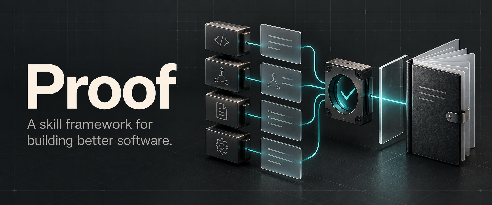

# Proof



**A skill framework for building better software with AI agents.**

Proof gives a coding agent **26 composable engineering skills**: understand the
problem, plan a bounded change, build, test, review and prepare delivery with
evidence. Start by describing what you want in plain language; choose individual
skills as you become familiar with the framework. Claude Code is the full plugin
target. Generated packs provide a reduced knowledge/tool path for other hosts.

**Proof 4 beta candidate:** this checkout uses only `proof-*` skill names, with no
legacy aliases. Published `main` is still v3.0.0. Package/protocol checks do not
establish a native installed-agent session or marketplace approval.

[](LICENSE)
[](#the-skills)
[](https://github.com/santapong/Proof/actions/workflows/validate.yml)

[Docs](docs/README.md) · [All 26 skills](docs/skills.md) · [First task](docs/getting-started.md) · [Quick start](#quick-start) · [Architecture](#architecture) · [Team workflow](#software-team-workflow) · [Skills](#the-skills) · [Migration](docs/migration-proof-4.md) · [Contributing](#contributing)

_Formerly Heimdall and TheLoopSkill. Those are historical product names, not aliases._

## Quick start

For this candidate, use its local checkout from a project you want to work on:

```sh
cd /path/to/your-project
claude --plugin-dir /absolute/path/to/this-proof-checkout
```

Choose a concrete task:

```text
/proof:proof-guide I want a small app to track workshop supplies. Help me define a first useful version.
/proof:proof-review the changes on this branch; report evidence and do not edit files
```

Claude Code namespaces plugin skills as `/<plugin>:<skill>`. Project/personal
copies use `/proof-guide`; Codex packs use `$proof-guide`. Follow the
[first-task guide](docs/getting-started.md) for setup, inputs, expected results
and troubleshooting. The normal GitHub marketplace install still delivers the
published release; use its matching documentation until Proof 4 is released.

Use `proof-guide` when you need help choosing a skill. Go directly to the relevant
skill when the task is already clear. See [INSTALL.md](INSTALL.md) for local
installation and other hosts, and the [software-team guide](docs/software-team.md)
for intake, handoffs, and context advice.

## Architecture


The **agent session** reads a skill and the references needed for the task.
Small work stays inline; when a supported, authorized Workflow is useful,
`proof-engine` authors the script and the host executes it. `proof-mcp` supplies
source-backed authoring advice. Report the artifact, actual checks and remaining
gaps, then follow the applicable next step or human gate.

| Part | Responsibility |
| --- | --- |
| Skills and references | Thin `SKILL.md` entrypoints; deeper guidance loaded when needed |
| Shared policies | Workflow shape, canonical `ROUTES`, lifecycle phases, and gates |
| Workflow templates | Pipelines, justified parallel barriers, and bounded discovery loops |
| `proof-mcp` | Routing explanation, boundary lookup, estimation, validation, and standards lookup |
| Repository checks | Structural validation, executable template smoke checks, routing parity, host packs, and local helper checks |

Explore the [architecture guide](docs/c4/README.md),
[detailed skill composition](docs/c4/diagrams/skill-composition.svg), or
[runtime and development views](docs/views/4plus1.md). The [artwork guide](docs/assets/README.md) records the editable sources, PNG alternatives and visual-check scope.

## Software-team workflow


Start with the task, repository state, constraints, and acceptance evidence.
Read the relevant references, run the phase, and hand back changed paths, check
results, and unresolved findings. `proof-review` reviews a diff; `proof-test`
produces tests; `proof-debug` investigates a reproducible failure. Keep those
responsibilities explicit in a handoff.

The execution dial is `--mode lite | balanced | all-out` where the selected skill
supports it. `balanced` is the default; `all-out` adds a pre-flight estimate before
execution. Exact model tiers and verification widths live in
[execution-modes.md](.claude/skills/proof-engine/references/execution-modes.md).
The autonomous improvement workflow remains **propose-only**: it drafts changes
and PRs for review.

## The skills

| Need | Start here |
| --- | --- |
| Choose a skill or understand an unfamiliar repo | `proof-guide`, `proof-comprehend` |
| Assess an idea, find prior art, or research a question | `proof-venture`, `proof-scout`, `proof-research` |
| Plan work and manage its context | `proof-orchestrate`, `proof-context` |
| Design a system, interface, or algorithm | `proof-design`, `proof-frontend`, `proof-algo` |
| Build and improve an implementation | `proof-build`, `proof-engine`, `proof-pattern` |
| Diagnose, test, review, or evaluate | `proof-debug`, `proof-test`, `proof-review`, `proof-audit`, `proof-experiment` |
| Integrate and prepare a release | `proof-integrate`, `proof-ship` |
| Operate a service or investigate an incident | `proof-operate`, `proof-incident` |
| Document and improve the workflow itself | `proof-docs`, `proof-skill`, `proof-harness`, `proof-autopilot` |

See the [complete task catalog](docs/skills.md), the [framework review](docs/reviews/framework-review-2026-10-23.md), and the [skill atlas](docs/c4/skills.md) for visual groupings and
[boundary audit](docs/design/boundary-audit.json) for the separating questions
between overlapping skills. Flags are specific to each skill's entrypoint.

## Optional local ML

The source checkout includes a **local context advisor**. Its default lexical
matcher suggests candidate skills and a reading plan. An opt-in Naive Bayes
classifier can add learned suggestions; both paths use Node's standard library
and make no provider calls.

```sh
# Default: no training or model file required.
node scripts/software-context.mjs rank --task "Review this branch for defects"

# Experimental: train locally, then request learned suggestions.
node scripts/software-context.mjs train --data docs/examples/software-routing-train-proof-v4.jsonl --out /tmp/proof-routing.json
node scripts/software-context.mjs rank --task "Review this branch for defects" --model /tmp/proof-routing.json
```

Choose a fresh output path for each training run. The classifier cannot change
permissions, verification gates, or execution-model choices. On the published
40-request synthetic routing set, its first candidate was correct on **23/40**,
versus **29/40** for lexical matching. It remains experimental; actual token and
cost savings are unmeasured. [Training guide](docs/software-team.md) ·
[Evaluation and limitations](docs/examples/software-efficiency-evaluation-final.md).

## Other hosts

Generated packs carry **22 of the 26 skills** to **Cursor, OpenAI Codex, and
Antigravity**. They preserve portable guidance and references while excluding
Claude-specific workflow scripts and four native skills. This is a packaging
boundary, not a claim of equivalent multi-agent execution in every host.

[Install a host pack](INSTALL.md) ·
[Packaging design](docs/design/ADR-0008-host-packaging-seam.md) · [Host status](ROADMAP.md).

## Contributing

Ordinary work branches from and targets **`develop`**; **`main`** carries releases.
Use a focused `feat/*`, `fix/*`, `docs/*`, or other documented branch and remove it
after verified integration. See the [branch policy](docs/branch-policy.md).

[Contributing and checks](CONTRIBUTING.md) · [Changelog](CHANGELOG.md) ·
[Architecture sources](docs/c4/README.md#diagram-sources-and-rendering) · [Proof identity](docs/identity.md).

## License

[MIT](LICENSE) © santapong
