# Engine authoring flow — proof-engine

This view explains the responsibilities in `proof-engine/SKILL.md`. They are
**instructions interpreted by the agent**, not seven separately deployed code
modules. The important boundary is authoring in the session versus execution
inside a host-provided Workflow sandbox.

[Editable source](diagrams/src/component-engine.mmd).

| Responsibility | Source-backed behavior |
| --- | --- |
| Resolve request | Interpret supported flags and current scope; do not guess unknown values |
| Map phases | Use the selected lifecycle and only applicable stages/gates |
| Choose shape | Pipeline by default; barriers for a real cross-item reduce; bounded loops for unknown discovery |
| Author script | Adapt the closest template, schemas and task parameters before estimating execution |
| Estimate/pre-flight | Under all-out, follow the shared §M6 estimate and required answer before calling Workflow |
| ROUTES | Copy §M8 byte-identically; the host evaluates node options at runtime |
| Report | Preserve actual checks, results, dead/no-verdict cases and unavailable usage; stop at a required gate |

`proof-orchestrate` supplies a plan and authored handoff. A plan-only request
stops there; execution belongs to the engine when also authorized. Neither layer
maintains a second route table or a second pre-flight procedure.

## The two execution contexts

The session can read source, retrieve evidence and ask for an answer when needed.
The template contract targets a deterministic host sandbox without filesystem,
module import, a clock or human prompts. That restriction explains the pure
`meta` literal, defensive argument normalization and intentional ROUTES copies.
It is a host contract to qualify, not a sandbox implemented by this repository.

The [canonical modes reference](../../.claude/skills/proof-engine/references/execution-modes.md)
owns exact routes, widths and estimates. Model pins and local stub tests do not
establish provider availability, real token use or successful native execution.

[Context](context.md) · [Content/runtime map](container.md) · [Architecture index](README.md).
