# Content and runtime map — Proof

This is a **C4-inspired content/runtime view**. C4 containers ordinarily describe
applications and data stores; Proof also needs to show separately loaded
instruction artifacts. The diagram labels those as artifacts rather than
pretending every Markdown file is a deployable process. See the
[official C4 container definition](https://c4model.com/diagrams/container).

[Editable source](diagrams/src/container.mmd).

| Part | Actual role |
| --- | --- |
| Plugin manifests | Discovery/install metadata |
| 26 skill routers | Task selection and bounded method instructions |
| Reference library | On-demand specialist knowledge and dated standards shelves |
| Shared policies | One authority for shapes, loops, routes and gates |
| AIDLC / VENTURE | Two selectable lifecycle definitions; the template is an authoring scaffold |
| 32 Workflow templates | Read/adapted in the session; executed only by a capable host |
| Boundary matrix / ADRs | Live selection contracts versus historical decisions |
| `proof-mcp` | A local Node stdio process: five authoring tools and read-only resources |
| Repository checks | Local/CI structural, stub-execution and package evidence |
| Generated host packs | 22 knowledge skills; four native skills and Workflow scripts excluded |

## Three paths

**Inline:** task → selected skill/references → scoped work → checked artifact.
No Workflow or agent team is required merely because a skill is used.

**Workflow:** scope and authoring → shared policy/template → any required
pre-flight → authorized host execution → actual results and phase gate. MCP
advises authoring; it is not drawn as a service inside that sandbox.

**Packaging:** canonical source → deterministic pack build → reviewed host
installation. The emitted MCP path must resolve to a retained complete source
checkout. Packaging is not native-host acceptance.

The [engine flow](component.md) explains interpreted authoring responsibilities;
the [execution-placement view](../views/4plus1.md#4--physical-view) separates the
Proof checkout, target code, local MCP process and host-managed execution.
