# System context — Proof

Proof is a software-engineering skill framework packaged as a Claude Code plugin,
with reduced knowledge packs for other hosts. It ships instructions, references,
workflow scaffolds and a local source-reading MCP server. The host supplies the
agent session, model access, permissions and any Workflow execution capability.

[Editable source](diagrams/src/context.mmd). The compact view is
[context-glance.svg](diagrams/context-glance.svg).

## Read the boundaries

- A person brings a software goal or a known deliverable. Small tasks can run
  inline; a Workflow is an optional execution path with real prerequisites.
- The host loads the selected skill and relevant references. Explicit invocation,
  metadata and current task context all affect discovery.
- The target project is the subject of work. Reads, edits and delivery follow
  the user's scope; the diagram does not enforce filesystem permissions.
- A configured provider serves model calls. Repository pins are implementation
  choices, not proof that an account has access or that those models are best.
- GitHub feedback/proposals require an authorized configuration. The default
  maintenance pass is dry; no source diagram enables unattended actions.
- Reduced packs carry 22 skills and an MCP configuration fragment. Native
  discovery, connection and task completion need their own checks.

## What Proof owns

The source library and `proof-mcp` implementation belong to Proof. The MCP server
has a local stdio process lifecycle; the plugin instructions are not a hosted
service. Workflow sandbox deployment internals belong to the host and are not
asserted here. Detailed roles are in the [26-skill catalog](../skills.md).

[Content/runtime map](container.md) · [Engine authoring flow](component.md) ·
[Architecture index](README.md).
