# Skill relationships — Proof

All 26 skills, grouped by the outcome and handoff they own. The diagrams are source-backed maps of instructions, not evidence that each host workflow has run.

**One diagram per skill would be twenty-six copies of the same picture.** Skills share a router-and-reference structure, with templates where the task needs them — which is drawn once below as the *skill container view* and explained in [`skill-anatomy.md`](skill-anatomy.md). What actually differs between skills is their **relationships**: who delegates to whom, and where each one stops. So the per-skill views are grouped by role, and each shows the edges that make its members distinct.

---

## The skill container view — shared structure

Zoom into any single skill and this is what you find. The three parts are separate **because they load differently**, which is the constraint the whole design turns on.

Diagram source: [`diagrams/src/skill-container-view.mmd`](diagrams/src/skill-container-view.mmd) · regenerate with `node scripts/render-diagrams.mjs`

The router enters context on invocation. References and templates enter context when read during authoring; the host then executes the authored script in a separate sandbox. Progressive disclosure limits what is loaded, but does not make template authoring free.

---

## Engine & planning

The execution layer authors through `proof-engine`; inline specialists need no workflow. `proof-skill` authors the skills themselves. See [all 26 task outcomes](../skills.md).

Diagram source: [`diagrams/src/skills-engine-planning.mmd`](diagrams/src/skills-engine-planning.mmd) · regenerate with `node scripts/render-diagrams.mjs`

**Where each stops.** A plan-only `proof-orchestrate` request stops at the handoff; `proof-engine` runs one task now. `proof-skill` changes what Claude *knows how to do* — `proof-harness` changes what it is *permitted* to do.

---

## Design & mechanism

Three altitudes on "how should this be built", separated by the shape of the deliverable.

Diagram source: [`diagrams/src/skills-design-mechanism.mmd`](diagrams/src/skills-design-mechanism.mmd) · regenerate with `node scripts/render-diagrams.mjs`

**The tests.** Boxes and contracts → `proof-design`. A complexity bound or an invariant → `proof-algo`. A structural refactor with behavioral-check evidence → `proof-pattern`. Optimization may also pass unchanged correctness tests; its requested result is the mechanism/performance argument. *Shard the queue across N nodes* is design; *which lock-free queue and what are its progress guarantees* is mechanism.

---

## Build & verify

Everything that inspects or proves code. The split is the **artifact each produces**.

Diagram source: [`diagrams/src/skills-build-verify.mmd`](diagrams/src/skills-build-verify.mmd) · regenerate with `node scripts/render-diagrams.mjs`

**The tests.** Findings list or diff? → review vs pattern. Backward over a diff, or forward over a rollout? → audit vs ship. Can you paste a stack trace? → debug. Is the service *down*? → incident, not debug.

---

## Integrate & ship

Both face outward — one at someone else's API, one at production.

Diagram source: [`diagrams/src/skills-integrate-ship.mmd`](diagrams/src/skills-integrate-ship.mmd) · regenerate with `node scripts/render-diagrams.mjs`

**The tests.** Is the reuse/adopt/build decision still open? → `proof-scout` first, then `proof-integrate`. Does this system *publish* the API or *consume* it? → design vs integrate. Idempotency appears in both, as different obligations: design requires callers to send a key, integrate requires this system to send one.

---

## Run & respond

The thinnest boundary in the fleet, held apart by one checkable predicate.

Diagram source: [`diagrams/src/skills-run-respond.mmd`](diagrams/src/skills-run-respond.mmd) · regenerate with `node scripts/render-diagrams.mjs`

**After honoring a declared incident or organizational declaration criteria:** *does a runbook exist for this condition, **and** does executing it restore the SLI?* Yes → `proof-operate`, no declaration. No, or the impact exceeds the runbook's scope, or a human must be paged → `proof-incident`. Only `proof-incident` writes postmortems.

This pair ships **on probation**: a review tripwire fires if either skill's body spends more than ~30% of its length restating the other's phase, on the grounds that one honest skill beats two fighting for the same trigger.

---

## Knowledge & automation

Cross-cutting support, plus the loop that composes everything.

Diagram source: [`diagrams/src/skills-knowledge-automation.mmd`](diagrams/src/skills-knowledge-automation.mmd) · regenerate with `node scripts/render-diagrams.mjs`

**The tests.** A runbook is markdown but its steps are *executed*, possibly unattended — that is `proof-operate`, not `proof-docs`. A postmortem belongs to `proof-incident`, which owns the timeline data. `proof-research` gathers evidence for any question; `proof-scout` answers one specific question — should we build this — and delegates its searching here.

---

**See also:** [Context (L1)](context.md) · [Container (L2)](container.md) · [Component (L3)](component.md) · [skill anatomy](skill-anatomy.md) · [the normative boundary matrix](../design/boundary-audit.json)
