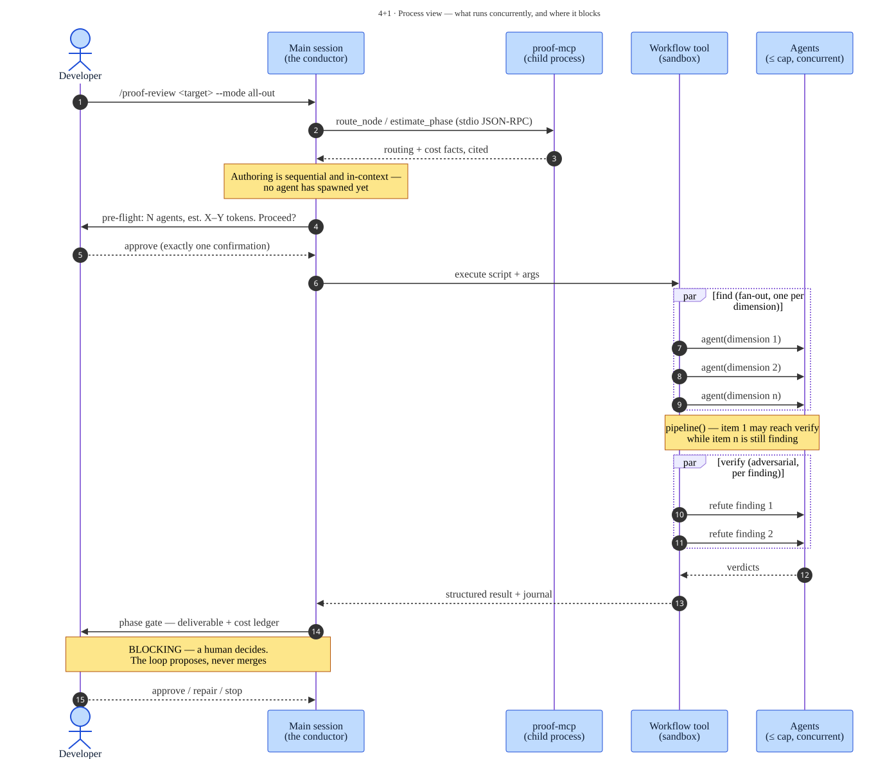

# The 4+1 views — Proof

These complementary views explain the same source framework from different
questions. They are source-backed documentation, not evidence that every host,
provider or unattended scenario has run successfully.

| View | Reader question |
| --- | --- |
| [Logical](#1--logical-view) | Which responsibilities exist, and who owns them? |
| [Process](#2--process-view) | What can run concurrently, and where must work wait? |
| [Development](#3--development-view) | Which source modules, builders and checks change together? |
| [Physical](#4--physical-view) | Which execution placement is known, and which belongs to the host? |
| [Scenarios](#1--scenarios) | Do the other views support an actual task without inventing a capability? |

## 1 · Logical view

The 26 skills are grouped into seven engine/planning roles, eighteen domain
roles and one repository-maintenance role. These are explanatory groups, not
separate services. The [skill catalog](../skills.md) owns the reader-facing task
map; the [boundary matrix](../design/boundary-audit.json) owns selection contracts.

Shared workflow policy constrains authoring and execution. Guide routes an
unclear task; orchestrate plans named work; build conducts an agreed brief;
engine executes an authorized Workflow. Inline specialists need no Workflow.
The autonomy loop is dry/propose-only by default and does not grant itself a
schedule, remote writes or a promotion.

## 2 · Process view

This is a large-review example, not the mandatory route for a two-file diff.
MCP advice is optional and happens during authoring. Under all-out, the session
shows the shared estimate and waits for the required answer before execution.

The review template gathers finder results, deduplicates at a real barrier, then
verifies surviving candidates. Same-model verification bursts are staggered as
the source policy specifies. Missing/dead verdicts stay unknown. A dry-run or a
declined run returns a plan/estimate with no workflow agents.

## 3 · Development view

Canonical source is under `.claude/skills/`, `mcp/`, `docs/` and `scripts/`.
Validation checks skill structure and ROUTES; smoke executes templates under
stubs; package checks build deterministic reduced packs; clean-copy stdio checks
exercise MCP identity and public names. These are different checks with different
coverage. Skill validation alone does not test the MCP server or model quality.

Editable `.mmd` sources generate committed SVGs through the pinned rendering
script. The overview separately uses Archify JSON/HTML plus the native README
SVG generator. CI runs the checked-in workflow after a push; actual GitHub
protection/settings must be verified separately.

## 4 · Physical view

The local agent session, Proof source checkout, target project and Node stdio
MCP process are distinct. The source checkout supplies policies and resources;
the target project contains the code being developed. The diagram does not
assert that host Workflow internals run in-process or in a particular cloud.

A reduced-pack installation needs its own configured MCP process and a retained
complete source checkout at a resolvable path. It does not call another user's
local MCP process. Repository pins and generated configuration are not native
host acceptance evidence. Remote model calls, GitHub and provider integrations
follow the configured task and authorized scope, not a diagram's authority.

## +1 · Scenarios

- **Review:** pin the diff, read needed references, work inline or use an
  authorized Workflow, then report supported findings and actual scope.
- **Extend:** justify a new capability, register its boundary, author source and
  run relevant gates. Local evidence precedes any separately authorized push.
- **Maintain:** qualify a compatible runner and branch policy; produce dry
  proposals by default. Remote drafts and a human merge decision remain separate.
- **Port:** generate the knowledge pack, review paths/settings, install it and
  qualify discovery, MCP connection and one bounded task. The pack excludes the
  Workflow executor; it does not define all capabilities of the target host.

[Architecture index](../c4/README.md) · [Current review](../reviews/framework-review-2026-10-23.md)
· [Roadmap](../../ROADMAP.md).
